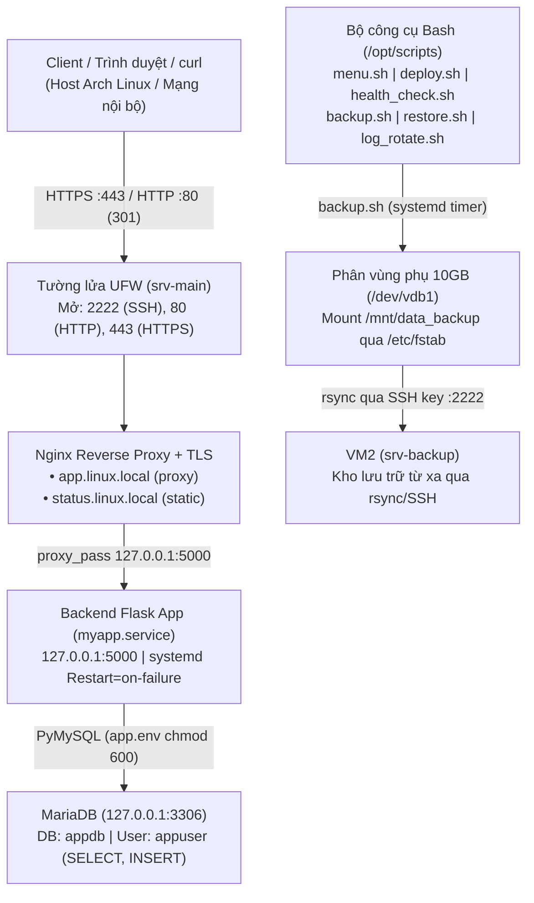
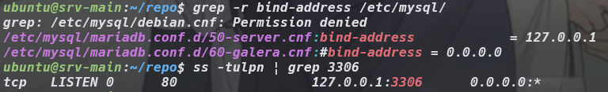
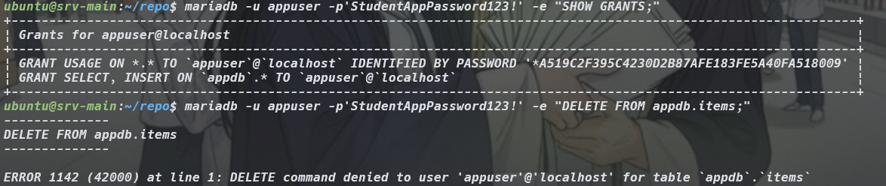
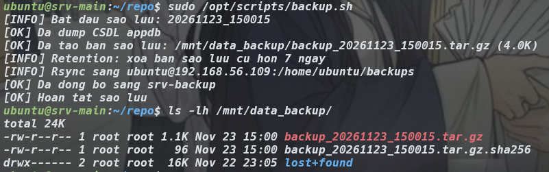
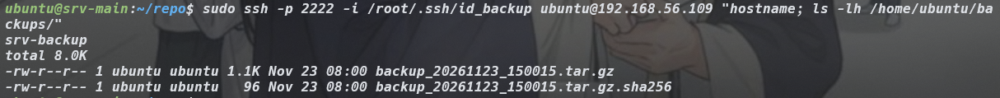
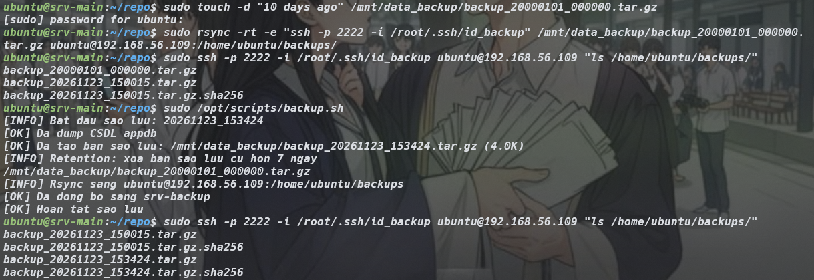
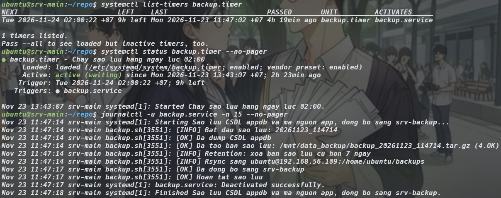
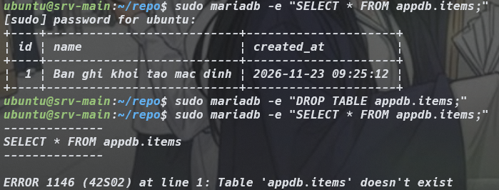
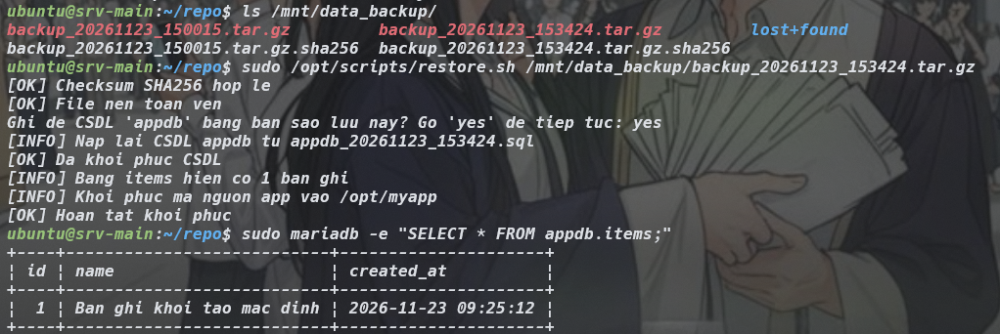

# BÁO CÁO KỸ THUẬT ĐỒ ÁN THỰC HÀNH LINUX (BẢN DEMO TỔNG HỢP)

**Môn học:** Hệ điều hành Linux & Ứng dụng — ĐHQG-HCM, Trường ĐH Khoa học Tự nhiên  
**Kiến trúc:** Hệ thống Web hợp nhất (Nginx Reverse Proxy + TLS $\rightarrow$ Flask Systemd App $\rightarrow$ MariaDB + Backup/Automation) trên 2 máy ảo Ubuntu 22.04 LTS Server (KVM/QEMU).

> [!NOTE]
> Đây là **bản thảo báo cáo tổng hợp** được xây dựng từ đóng góp của các thành viên trên nhánh `main` (TV1, TV2, TV3), các kịch bản tự động hóa trên nhánh dự phòng `feat/backup` (TV5), và cấu hình triển khai thực nghiệm trên `srv-main` (TV4). Trước khi xuất ra file `Bao_Cao_Ky_Thuat.pdf` nộp chính thức, nhóm cần điền thông tin MSSV/Họ tên, bổ sung các ảnh chụp màn hình còn thiếu (được đánh dấu `[CHÈN ẢNH]`), và gộp các cấu hình còn thiếu vào `main`.

---

## 1. Tổng Quan Hệ Thống & Phân Công Công Việc

### 1.1 Môi trường & Sơ đồ kết nối 2 VM
* **Trình ảo hóa:** KVM/QEMU (`libvirtd`) chạy trên máy chủ host Arch Linux.
* **Hệ điều hành khách:** Ubuntu 22.04.5 LTS Server (non-GUI, tài khoản quản trị non-root `ubuntu` có `sudo`).
* **Mạng ảo (`virbr0`):** Dải mạng `192.168.122.0/24`:
  * **VM1 (`srv-main`):** `192.168.122.117` — Máy chủ dịch vụ chính (Nginx, TLS, Flask `myapp.service`, MariaDB, Fail2ban, Auditd, bộ script vận hành).
  * **VM2 (`srv-backup`):** Máy chủ lưu trữ bản sao lưu từ xa qua `rsync`/SSH.

### 1.2 Bảng phân công 5 thành viên
| Thành viên | Vai trò chính | Thành phần phụ trách & Sản phẩm trong repo |
| :---: | :--- | :--- |
| **TV 1** | Hạ tầng & Gia cố HĐH | 2 VM KVM, `/etc/fstab`, SSH port `2222`, UFW ([configs/ssh/sshd_config](../configs/ssh/sshd_config), [configs/storage/fstab](../configs/storage/fstab), [scripts/setup_firewall.sh](../scripts/setup_firewall.sh)). |
| **TV 2** | CSDL & Sao lưu/Phục hồi | MariaDB `127.0.0.1`, `appuser`, `backup.sh`, `restore.sh`, `backup.timer` ([configs/database/](../configs/database), [scripts/backup.sh](../scripts/backup.sh), [scripts/restore.sh](../scripts/restore.sh), [docs/tv2/](./tv2)). |
| **TV 3** | Backend App & Systemd | Ứng dụng Flask (`GET/POST /api/items`, `/health`), `myapp.service`, `app.env` ([configs/backend/](../configs/backend)). |
| **TV 4** | Web Proxy, TLS & An ninh | Nginx 2 VHosts, OpenSSL TLS tự ký, HTTP 301 $\rightarrow$ HTTPS, Fail2ban, Auditd, Lynis *(cần commit config từ `srv-main` vào `main`)*. |
| **TV 5** | Tự động hóa & Vận hành | `menu.sh`, `deploy.sh`, `health_check.sh`, `log_rotate.sh`, chuẩn `shellcheck` *(hiện lưu trên nhánh `feat/backup`)*. |

---

## 2. Các Bước Xây Dựng Cốt Lõi (Tái tạo hệ thống)

1. **Khởi tạo hạ tầng & phân vùng lưu trữ (TV 1):**
   * Dựng VM bằng Cloud-Init ([configs/cloud-init/user-data-main.yaml](../configs/cloud-init/user-data-main.yaml)).
   * Gắn đĩa QCOW2 10GB (`/dev/vdb`), định dạng `ext4` và mount bền vững vào `/mnt/data_backup` bằng UUID (`UUID=752f02e2-b8ee-4e01-a1e9-21c7786da006`) trong [configs/storage/fstab](../configs/storage/fstab) để tồn tại sau reboot.
2. **Cơ sở dữ liệu MariaDB (TV 2):**
   * Ràng buộc lắng nghe nội bộ tại `bind-address = 127.0.0.1` trong [configs/database/50-server.cnf](../configs/database/50-server.cnf).
   * Chạy [configs/database/init_db.sql](../configs/database/init_db.sql) tạo database `appdb`, bảng `items`, và user `'appuser'@'localhost'` chỉ có quyền `SELECT, INSERT`.
3. **Ứng dụng Flask & Dịch vụ Systemd (TV 3):**
   * Mã nguồn [configs/backend/app.py](../configs/backend/app.py) cung cấp `GET /`, `GET /api/items`, `POST /api/items`, `GET /health` chạy tại `127.0.0.1:5000`.
   * Thông tin kết nối tách ra `/etc/myapp/app.env` (theo mẫu [app.env.example](../configs/backend/app.env.example)) với quyền hạn chế `chmod 600`.
   * Đóng gói bởi [configs/backend/myapp.service](../configs/backend/myapp.service) (`User=ubuntu`, `Restart=on-failure`, `RestartSec=3s`, `StandardOutput=journal`, `StandardError=journal`).
4. **Reverse Proxy Nginx & TLS/HTTPS (TV 4):**
   * Phục vụ 2 Virtual Hosts trên cùng máy chủ Nginx: `app.linux.local` (reverse proxy tới `http://127.0.0.1:5000` kèm các header `Host`, `X-Forwarded-For`, `X-Forwarded-Proto`) và `status.linux.local` (trang trạng thái tĩnh).
   * Tự động chuyển hướng HTTP (80) $\rightarrow$ HTTPS (443) với mã `301`.

### Vì sao dùng chứng chỉ TLS tự ký thay vì Let's Encrypt?
* Let's Encrypt cấp chứng chỉ qua giao thức ACME bằng cách yêu cầu máy chủ Let's Encrypt từ Internet truy cập ngược vào tên miền công khai của server trên cổng `80`/`443` để xác thực quyền sở hữu.
* Hệ thống lab chạy trên mạng ảo nội bộ (`192.168.122.0/24`) với tên miền cục bộ (`app.linux.local`, `status.linux.local`), không có IP công khai và không định tuyến từ Internet vào được, nên xác thực ACME chắc chắn thất bại.
* Do đó, nhóm sử dụng cặp khóa và chứng chỉ tự ký X.509 bằng `openssl` (hạn 365 ngày) đặt tại `/etc/ssl/certs/lab-selfsigned.crt` để mã hóa toàn bộ lưu lượng HTTPS nội bộ.

---

## 3. Gia Cố Bảo Mật (Security Hardening)

### 3.1 Tường lửa UFW ([configs/firewall/ufw_status.txt](../configs/firewall/ufw_status.txt))
* Chính sách mặc định: `deny (incoming)`, `allow (outgoing)`.
* Chỉ mở 3 cổng tối thiểu:
  * **`2222/tcp`:** Cổng SSH quản trị (đã đổi khỏi cổng mặc định `22` để giảm nhiễu quét tự động).
  * **`80/tcp`:** Nhận kết nối HTTP để chuyển hướng `301` sang HTTPS.
  * **`443/tcp`:** Cổng phục vụ chính thức qua TLS/HTTPS.
* Cổng nội bộ `3306` (MariaDB) và `5000` (Flask) hoàn toàn không mở ra ngoài.

### 3.2 Gia cố SSH ([configs/ssh/sshd_config](../configs/ssh/sshd_config))
* Thiết lập `Port 2222`, `PermitRootLogin no`, `PubkeyAuthentication yes`, `AllowUsers ubuntu`.
* **Đánh đổi:** `PasswordAuthentication yes` được giữ lại có kiểm soát trong phạm vi lab để phục vụ mô phỏng kiểm thử tấn công dò mật khẩu cho `fail2ban` khi demo (trên môi trường production thực tế sẽ tắt hoàn toàn password auth).

### 3.3 Fail2ban, Auditd & Lynis (Trên `srv-main`)
* **Fail2ban:** Jail SSH theo dõi nhật ký đăng nhập sai và tự động chặn IP nguồn sau 3 lần thất bại.
* **Auditd:** Theo dõi đọc/ghi/thay đổi trên `/etc/passwd` và `/etc/shadow` với khóa tìm kiếm `sensitive_auth_changes`, truy vết được `auid` gốc của người dùng kể cả khi dùng `sudo`.
* **Lynis:** Đạt điểm hardening `62` $\rightarrow$ `63` sau khi khắc phục 3 khuyến nghị (`BANNER-7126`, `AUTH-9286`, `FILE-6310`).

> **[CHÈN ẢNH]:** Ảnh chụp `ufw status verbose`, `fail2ban-client status sshd`, `ausearch -k sensitive_auth_changes -i`, và log trước/sau của Lynis trên `srv-main`.

---

## 4. Sao Lưu & Khôi Phục Thảm Họa (TV 2)

### 4.1 Kiến trúc sao lưu & chính sách lưu giữ
* **Script sao lưu:** [scripts/backup.sh](../scripts/backup.sh) đọc cấu hình từ `/etc/backup.conf` ([backup.conf.example](../configs/backup/backup.conf.example)).
* **Quy trình thực hiện:**
  1. Kiểm tra `mountpoint -q /mnt/data_backup` để tránh ghi tràn vào phân vùng gốc `/`.
  2. Dùng khóa `flock -n` (`/var/lock/backup.lock`) ngăn chạy chồng chéo giữa lịch tự động và chạy tay.
  3. Dump CSDL `appdb` (`mysqldump --single-transaction --routines --triggers`) và đóng gói cùng mã nguồn `/opt/myapp` thành `backup_YYYYmmdd_HHMMSS.tar.gz`, đồng thời sinh file kiểm tra toàn vẹn `.sha256`.
  4. Áp dụng **retention policy** (`RETENTION_DAYS=7`, hỗ trợ cờ `-d`) tự động xóa bản sao lưu cũ hơn ngưỡng trên cả `srv-main` và `srv-backup`.
  5. Đồng bộ sang `srv-backup` bằng `rsync` qua SSH key (`/root/.ssh/id_backup`, cổng `2222`).
* **Lập lịch tự động:** Sử dụng [backup.service](../configs/systemd/backup.service) và [backup.timer](../configs/systemd/backup.timer) chạy lúc `02:00:00` hằng ngày (`Persistent=true`).

### 4.2 Quy trình khôi phục & Bằng chứng kiểm thử
* **Script khôi phục:** [scripts/restore.sh](../scripts/restore.sh) hỗ trợ `-d` (chỉ CSDL), `-y` (bỏ qua hỏi xác nhận). Kiểm tra checksum `sha256sum -c` và `tar -tzf` trước khi giải nén, nạp lại SQL vào `mariadb`, đếm số bản ghi `items`, khôi phục mã nguồn và khởi động lại `myapp`.
* **Bằng chứng thực nghiệm đã có sẵn trong repo (`docs/tv2/images/`):**
  * MariaDB chỉ nghe trên `127.0.0.1` và chặn `appuser` thực hiện `DELETE`:  
  * Chạy `backup.sh`, đồng bộ sang `srv-backup`, retention & `backup.timer`:    
  * Diễn tập thảm họa (`DROP TABLE` $\rightarrow$ `restore.sh` phục hồi nguyên vẹn):  

---

## 5. Bộ Công Cụ Vận Hành & Tự Động Hóa (Nhánh `feat/backup`)

Toàn bộ script dùng chuẩn `#!/usr/bin/env bash`, `set -euo pipefail`, bẫy lỗi `trap ... ERR`/`EXIT`/`SIGINT`, hỗ trợ `--help`/`getopts`, và đã vượt qua `shellcheck /opt/scripts/*.sh` với 0 lỗi trên `srv-main`.

| Script | Mục đích & Tham số | Cơ chế xử lý lỗi & Cảnh báo |
| :--- | :--- | :--- |
| **`menu.sh`** | Giao diện CLI tương tác (7 lựa chọn điều phối toàn bộ script + chạy `shellcheck`). | Kiểm tra đầu vào bằng `case`, bắt `SIGINT` để thoát an toàn. |
| **`deploy.sh`** | Triển khai mã nguồn vào `/opt/myapp`, đặt quyền `ubuntu:ubuntu` / `755`. | Chụp snapshot trước khi deploy vào `/tmp/deploy_snapshot_*`; nếu lỗi cú pháp/restart thì **tự động rollback**. *(Lưu ý trước demo: kiểm tra lại dòng `myapp.servic` thành `myapp.service` trong hàm `rollback()`).* |
| **`health_check.sh`** | Giám sát CPU (`-c`, mặc định `80%`), RAM (`-m`, `85%`), Disk (`-d`, `80%`), cổng và dịch vụ. | Ghi log `/var/log/system_health.log` và phát cảnh báo khi vượt ngưỡng hoặc dịch vụ ngừng hoạt động. |
| **`log_rotate.sh`** | Xoay vòng và nén `.gz` file log chỉ định (`-f <path>`, `-n <keep_count>`, mặc định `5`). | Dồn thế hệ nén cũ từ cao xuống thấp, làm rỗng file log gốc (`chmod 644`), xóa bản vượt quá `keep_count`. |
| **`backup.sh` & `restore.sh`** | Sao lưu và phục hồi CSDL + ứng dụng (`-d`, `-s`, `-y`, `--help`). | `flock`, kiểm tra `mountpoint`, xác thực `.sha256`, `trap on_exit EXIT` dọn file tạm. |

> **[CHÈN ẢNH]:** Ảnh chụp `menu.sh` đang chạy, test `deploy.sh` rollback khi cố tình gây lỗi cú pháp, `health_check.sh` phát cảnh báo khi dừng dịch vụ, và output `shellcheck /opt/scripts/*.sh` sạch 100%.

---

## 6. Kịch Bản Demo Trực Tiếp (12–15 Phút)

1. **Khởi động & Hạ tầng (TV 1 — 2 phút):** Show 2 VM, `lsblk` & `mount | grep data_backup`, `sudo ufw status verbose`, giải thích cấu hình `sshd_config` cổng `2222`.
2. **CSDL & Backend (TV 2 & TV 3 — 3 phút):** `ss -tulpn | grep 3306` chứng minh `127.0.0.1`; test `POST` và `GET /api/items` qua Nginx; `ls -l /etc/myapp/app.env` (`600`); chạy `kill -9 <PID>` và xem `journalctl -u myapp.service` chứng minh tự khởi động lại.
3. **Web Proxy, TLS & Bảo mật (TV 4 — 3 phút):** `curl -k -I` cả `app.linux.local` và `status.linux.local` (chứng minh 301 HTTP $\rightarrow$ HTTPS); mô phỏng SSH sai mật khẩu để `fail2ban` ban IP trực tiếp; xem `ausearch -k sensitive_auth_changes -i` và báo cáo Lynis.
4. **Sao lưu & Phục hồi (TV 2 — 3 phút):** Thực hiện theo [TV2_huong_dan_demo.md](./tv2/TV2_huong_dan_demo.md): chạy `backup.sh`, show file & `.sha256` trên `srv-backup`, xóa bảng `items` rồi chạy `restore.sh` khôi phục trực tiếp.
5. **Tự động hóa (TV 5 — 3 phút):** Mở `menu.sh`, demo `deploy.sh` tự động rollback khi cấu hình lỗi, mô phỏng lỗi để `health_check.sh` cảnh báo, xoay vòng log với `log_rotate.sh`, và chạy `shellcheck /opt/scripts/*.sh` tại chỗ.
