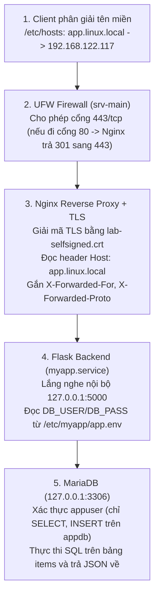

# TÀI LIỆU GIẢI THÍCH HỆ THỐNG & ÔN TẬP VẤN ĐÁP (CHO CẢ 5 THÀNH VIÊN)

> [!IMPORTANT]
> Theo quy định chấm điểm của Khoa (**Mục 1.2 & Mục 9** trong đề bài): điểm chấm theo **cá nhân trên nền điểm nhóm**. Giảng viên có thể hỏi **bất kỳ thành viên nào về bất kỳ thành phần nào** của hệ thống. Không giải thích được phần mình phụ trách hoặc không hiểu luồng tổng thể sẽ bị trừ điểm cá nhân dù hệ thống chạy tốt.

---

## 1. Bức Tranh Tổng Thể: Điều Gì Xảy Ra Khi Người Dùng Gửi 1 Request?

Giả sử người dùng mở trình duyệt hoặc chạy `curl -k https://app.linux.local/api/items` (hoặc `POST` dữ liệu mới):

**Tóm tắt 5 bước trả lời nhanh khi thầy hỏi *"Trình bày từng bước một request đi từ client vào CSDL"*:**
1. Client phân giải tên miền `app.linux.local` thành IP của `srv-main` (`192.168.122.117`).
2. Gói tin đi qua tường lửa **UFW** (chỉ mở cổng `80`, `443`, `2222`). Nếu đi HTTP (`80`), Nginx trả về mã `301` ép chuyển sang HTTPS (`443`).
3. **Nginx** kết thúc phiên mã hóa TLS (TLS termination) bằng chứng chỉ tự ký, kiểm tra tên `Host` để phân biệt giữa `app.linux.local` và `status.linux.local`, rồi chuyển tiếp (`proxy_pass`) vào `127.0.0.1:5000` kèm header gốc của client (`X-Forwarded-For`, `X-Forwarded-Proto`).
4. Ứng dụng **Flask** (chạy dưới quyền `ubuntu` bởi `systemd`) nhận request, dùng biến môi trường từ `/etc/myapp/app.env` để kết nối tới MariaDB.
5. **MariaDB** (chỉ nghe ở `127.0.0.1:3306`) kiểm tra quyền `appuser` (chỉ có `SELECT`/`INSERT` trên `appdb.*`), thực thi truy vấn trên bảng `items` và trả kết quả JSON ngược lại qua Nginx về client.

---

## 2. Tóm Tắt Từng Thành Phần Để Cả Nhóm Hiểu Sâu

### Phần 1 — Hạ tầng, Lưu trữ & Tường lửa (TV 1)
* **2 VM (`srv-main` & `srv-backup`):** Tách máy chạy dịch vụ chính và máy lưu bản sao lưu từ xa theo nguyên tắc dự phòng. Nếu `srv-main` chết ổ cứng hoàn toàn, dữ liệu backup vẫn an toàn trên `srv-backup`.
* **Mount đĩa phụ `/mnt/data_backup` bằng UUID trong [`../configs/storage/fstab`](../configs/storage/fstab):**
  * Dùng **UUID** thay vì `/dev/vdb1` vì tên thiết bị `/dev/vdX` có thể thay đổi thứ tự khi gắn thêm đĩa ảo hoặc khởi động lại, còn UUID là định danh duy nhất gắn liền với phân vùng `ext4`.
  * Nếu ổ phụ chưa mount, dữ liệu sao lưu sẽ không ghi tràn vào phân vùng gốc `/`.
* **Tường lửa UFW ([`../configs/firewall/ufw_status.txt`](../configs/firewall/ufw_status.txt)):**
  * Chính sách mặc định: **chặn toàn bộ chiều vào (`deny incoming`)**, chỉ mở đúng `2222` (SSH), `80` (HTTP redirect), `443` (HTTPS).
  * Cổng `3306` (MariaDB) và `5000` (Flask) **không mở trên UFW** để tránh truy cập trực tiếp từ mạng ngoài (buộc mọi traffic web phải đi qua Nginx).
* **Gia cố SSH ([`../configs/ssh/sshd_config`](../configs/ssh/sshd_config)):**
  * `Port 2222`: Tránh bot tự động rà quét cổng `22` mặc định.
  * `PermitRootLogin no`: Chặn đăng nhập trực tiếp bằng `root` (buộc attacker phải đoán cả tên user lẫn mật khẩu/khóa, đồng thời có dấu vết `sudo` gắn với user cụ thể).
  * `AllowUsers ubuntu`: Chỉ cho phép đúng tài khoản quản trị `ubuntu` đăng nhập SSH.
  * *Đánh đổi:* Giữ `PasswordAuthentication yes` trong lab để phục vụ trình diễn `fail2ban` dò sai mật khẩu; trên production thật phải tắt (`no`) và chỉ dùng SSH Key.

### Phần 2 — Cơ sở dữ liệu & Sao lưu/Khôi phục (TV 2)
* **MariaDB chỉ nghe `127.0.0.1` ([`../configs/database/50-server.cnf`](../configs/database/50-server.cnf)):** Vì Flask và MariaDB nằm cùng trên `srv-main`, ràng buộc `bind-address = 127.0.0.1` giúp đóng hoàn toàn khả năng kết nối trực tiếp từ mạng ngoài vào cổng `3306`.
* **Tài khoản `appuser` đặc quyền tối thiểu ([`../configs/database/init_db.sql`](../configs/database/init_db.sql)):** Chỉ cấp `SELECT, INSERT` trên `appdb.*`. Nếu ứng dụng web bị lỗi bảo mật (ví dụ SQL Injection), kẻ tấn công không thể dùng tài khoản của app để chạy `DROP TABLE`, `DELETE` hay xâm nhập CSDL khác.
* **Sao lưu [`../scripts/backup.sh`](../scripts/backup.sh) & [`../configs/systemd/backup.timer`](../configs/systemd/backup.timer):**
  * Dùng `flock` (`/var/lock/backup.lock`) tránh 2 tiến trình backup chạy đè lên nhau.
  * Kiểm tra `mountpoint -q /mnt/data_backup` tránh ghi nhầm vào ổ gốc `/` nếu ổ phụ rớt mount.
  * Dùng `mysqldump --single-transaction` để dump dữ liệu nhất quán mà không khóa bảng đang phục vụ người dùng.
  * Sinh mã băm `.sha256` đi kèm file `.tar.gz`, áp dụng **retention policy** (xóa file quá hạn trên cả `srv-main` và `srv-backup`), và đồng bộ qua `rsync` bằng SSH key.
* **Khôi phục [`../scripts/restore.sh`](../scripts/restore.sh):** Xác thực checksum `sha256sum -c` và `tar -tzf` trước khi nạp lại SQL vào MariaDB, hỏi xác nhận `yes` tránh ghi đè nhầm.

### Phần 3 — Ứng dụng Backend & Systemd (TV 3)
* **Flask App ([`../configs/backend/app.py`](../configs/backend/app.py)):** Giao tiếp MariaDB qua `PyMySQL`, có endpoint đọc (`GET /api/items`), ghi (`POST /api/items`), và kiểm tra sống (`GET /health`).
* **`EnvironmentFile` & `chmod 600` ([`../configs/backend/app.env.example`](../configs/backend/app.env.example)):** Tách mật khẩu DB khỏi mã nguồn (`app.py`) để không lộ bí mật khi đưa code lên Git. Quyền `600` (`rw-------`) đảm bảo chỉ chủ sở hữu mới đọc được mật khẩu, các user khác trên hệ thống không xem trộm được.
* **Systemd [`../configs/backend/myapp.service`](../configs/backend/myapp.service):**
  * `Restart=on-failure` + `RestartSec=3s`: Khi tiến trình bị crash hoặc bị `kill -9`, systemd nhận mã thoát khác 0 và tự khởi động lại sau 3 giây.
  * `StandardOutput=journal` & `StandardError=journal`: Gom log tập trung về `systemd-journald` để tra cứu bằng `journalctl -u myapp.service`.

### Phần 4 — Web Proxy, TLS & An ninh Phòng thủ (TV 4)
* **2 Virtual Hosts trên Nginx:** Cùng nghe cổng `443` trên 1 IP duy nhất (`192.168.122.117`), Nginx dựa vào **SNI** (khi bắt tay TLS) và HTTP header **`Host:`** để phân tuyến về `app.linux.local` (reverse proxy) hoặc `status.linux.local` (static HTML).
* **Chứng chỉ tự ký OpenSSL thay vì Let's Encrypt:** Let's Encrypt cần xác thực tên miền công khai từ Internet (ACME challenge gọi vào cổng `80`/`443`). Mạng lab nội bộ không có IP public nên ACME không vào được $\rightarrow$ bắt buộc dùng chứng chỉ tự ký (`openssl req -x509`).
* **Các Header proxy (`Host`, `X-Forwarded-For`, `X-Forwarded-Proto`):** Khi Nginx đứng trước proxy request vào Flask, Flask sẽ chỉ thấy IP của Nginx (`127.0.0.1`). Các header này giúp Flask biết tên miền gốc, IP thật của client và giao thức ban đầu là HTTPS.
* **Fail2ban:** Đọc log SSH (`/var/log/auth.log`), thấy IP gõ sai mật khẩu quá 3 lần sẽ chèn rule tường lửa chặn IP nguồn đó tạm thời.
* **Auditd:** Ghi nhận mọi thao tác đọc/ghi/thay đổi trên `/etc/passwd` và `/etc/shadow` ở tầng nhân (kernel), lưu `auid` giúp truy ra đúng user gốc ban đầu kể cả khi kẻ gian đã nâng quyền `sudo`.
* **Lynis:** Công cụ kiểm toán bảo mật hệ thống, chấm điểm Hardening Index (`62` $\rightarrow$ `63`) và đề xuất các mục cần gia cố (nhóm đã sửa 3 mục: `BANNER-7126`, `AUTH-9286`, `FILE-6310`).

### Phần 5 — Tự động hóa & Bộ công cụ Bash (TV 5 — nhánh `feat/backup`)
* **`set -euo pipefail` và `trap ... ERR`:**
  * `-e`: Dừng ngay khi có lệnh trả mã lỗi khác 0 (không chạy mù quáng các bước sau khi bước trước đã hỏng).
  * `-u`: Báo lỗi ngay nếu dùng biến chưa được khai báo (tránh lỗi nguy hiểm kiểu `rm -rf /$UNSET_VAR/`).
  * `-o pipefail`: Bắt lỗi trong đường ống pipe (`cmd1 | cmd2`) ngay cả khi `cmd1` chết nhưng `cmd2` thành công.
  * `trap ... ERR`: Tự động chạy hàm xử lý/dọn dẹp hoặc báo dòng lỗi (`$LINENO`) ngay khi script gặp sự cố.
* **`deploy.sh` & Rollback:** Tạo snapshot bản đang chạy tốt trước khi ghi đè; nếu kiểm tra cú pháp hoặc khởi động lại dịch vụ thất bại, tự động chép bản snapshot cũ trả lại nguyên trạng.
* **`health_check.sh`, `log_rotate.sh`, `menu.sh` & `shellcheck`:** Giám sát CPU/RAM/Disk/service, xoay vòng nén `.gz` giữ $N$ thế hệ log, gom toàn bộ vào menu CLI tương tác và đảm bảo 0 cảnh báo `shellcheck`.

---

## 3. Bộ Câu Hỏi Vấn Đáp Tiêu Biểu & Gợi Ý Trả Lời

| Câu hỏi của Giảng viên | Gợi ý trả lời ngắn gọn, trúng trọng tâm |
| :--- | :--- |
| **1. Vì sao mở đúng các cổng `2222`, `80`, `443`? Nếu mở thêm `3306` hay `5000` thì kẻ tấn công được lợi gì?** | `2222` để quản trị SSH từ xa; `80` chỉ để chuyển hướng 301 sang `443`; `443` phục vụ web mã hóa TLS. Nếu mở `3306` ra ngoài, attacker có thể dò mật khẩu DB trực tiếp (brute-force) hoặc khai thác lỗ hổng MariaDB mà không qua lớp ứng dụng. Nếu mở `5000`, attacker truy cập thẳng Flask bỏ qua TLS và giới hạn bảo vệ của Nginx. |
| **2. Sao lưu lúc 2 giờ sáng — nếu đĩa đầy thì sao? Script có phát hiện không?** | Có. Nhờ `set -euo pipefail`, nếu `mysqldump` hoặc `tar` ghi lỗi do hết đĩa (`ENOSPC`), lệnh trả mã lỗi khác 0 làm script dừng ngay và kích hoạt `trap on_exit EXIT` để xóa file nén dở dang (không lưu bản sao lưu lỗi). Ngoài ra, `backup.sh` kiểm tra `mountpoint -q /mnt/data_backup` để không làm đầy ổ root `/`, và `health_check.sh` cảnh báo sớm khi Disk vượt ngưỡng `80%`. |
| **3. Vì sao không dùng tài khoản `root` của MariaDB cho ứng dụng Flask?** | Theo nguyên tắc đặc quyền tối thiểu: tài khoản `root` DB có quyền xóa toàn bộ database, tạo user mới hoặc đọc ghi file hệ thống. Nếu Flask bị lỗi SQL Injection, kẻ tấn công sẽ chiếm toàn quyền DB. Dùng `appuser` chỉ có `SELECT, INSERT` trên `appdb.*` giúp khoanh vùng thiệt hại. |
| **4. Tại sao `EnvironmentFile` phải đặt `chmod 600`?** | File `/etc/myapp/app.env` chứa mật khẩu CSDL dạng văn bản thuần (plaintext). `chmod 600` đảm bảo chỉ user sở hữu (và `root`) mới đọc/ghi được; mọi tài khoản thường hoặc dịch vụ khác trên máy không thể đọc trộm mật khẩu này. |
| **5. `systemd` khác gì chạy nền bằng `&` hay `nohup`?** | `&` / `nohup` chỉ đẩy tiến trình chạy nền thủ công, nếu app bị lỗi thoát ngang hoặc server reboot thì app chết luôn. `systemd` quản lý vòng đời đầy đủ: tự khởi chạy lúc boot (`WantedBy=multi-user.target`), đợi đúng dịch vụ phụ thuộc (`After=mariadb.service`), tự động hồi sinh khi sập (`Restart=on-failure`), nạp biến môi trường an toàn và gom log về `journald`. |
| **6. Vì sao dùng chứng chỉ TLS tự ký thay vì Let's Encrypt?** | Let's Encrypt dùng giao thức ACME yêu cầu server từ Internet truy cập ngược vào tên miền thật qua cổng 80/443. Hệ thống lab nằm trong mạng ảo nội bộ (`192.168.122.0/24`), tên miền `.local` không tồn tại trên DNS công khai nên không xác thực ACME được; do đó chứng chỉ tự ký OpenSSL là lựa chọn đúng. |
| **7. `set -euo pipefail` giải quyết bài toán gì? Ở đâu nó cứu nhóm?** | Tránh việc script chạy tiếp âm thầm khi một bước trước đó đã thất bại (ví dụ `mysqldump` lỗi tạo file 0 byte nhưng `tar` vẫn nén và ghi đè backup rỗng, hoặc biến thư mục bị rỗng gây xóa nhầm file). Khi có lỗi, `-e` dừng ngay và `trap` dọn dẹp file tạm dở dang. |
| **8. `auditd` hơn gì xem log ứng dụng thông thường? `auid` là gì?** | `auditd` hoạt động ở tầng nhân Linux (kernel syscall), ghi lại mọi lần truy cập tệp nhạy cảm (`/etc/passwd`, `/etc/shadow`) kể cả khi kẻ gian không dùng ứng dụng mà thao tác trực tiếp qua shell. `auid` (Audit User ID) lưu lại ID user đăng nhập ban đầu (vd `ubuntu`) không bị thay đổi ngay cả sau khi chạy `sudo` lên `root` (`uid=0`), giúp truy vết đúng thủ phạm. |
