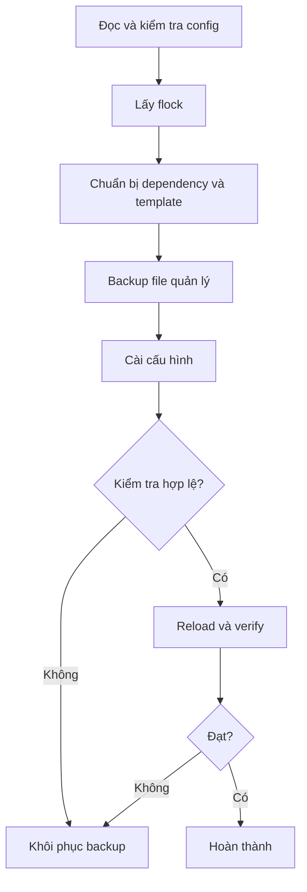

# Kiến trúc Web, TLS và Security

```mermaid
flowchart TD
    C[Client] -->|HTTP 80: redirect 301| N[Nginx]
    C -->|HTTPS 443| N
    N -->|app.linux.local| F[Flask 127.0.0.1:5000]
    N -->|status.linux.local| H[Static HTML]
    F --> D[MariaDB 127.0.0.1:3306]
    C -->|SSH 2222| S[OpenSSH]
    S --> L[auth.log]
    L --> B[Fail2ban]
    A[Auditd] --> P[/etc/passwd và /etc/shadow]
    Y[Lynis] --> R[Before / After]
```

## Web và TLS
HTTPS bảo vệ bí mật và toàn vẹn dữ liệu trên đường truyền; xác thực server phụ thuộc việc client tin cậy đúng chứng chỉ. Đây là lớp bảo vệ bổ sung, không thay thế phân quyền ứng dụng.

Nginx chọn virtual host theo hostname; app chuyển tiếp request vào Flask, status phục vụ HTML tĩnh, catch-all trả 404. HTTP chuyển hướng 301 sang HTTPS. SAN chứa cả hai domain. Certificate tự ký cần được client tin cậy một cách chủ động. Private key lưu trên server với mode 600, thư mục TLS mode 700. Nginx ghi riêng access/error log; proxy_log bổ sung upstream status và response time. Header Host, X-Real-IP, X-Forwarded-For, X-Forwarded-Proto mang thông tin request tới backend. Với một proxy trực tiếp, X-Forwarded-For được ghi đè bằng remote_addr để không tin giá trị do client gửi.

## Phòng thủ
UFW mặc định chặn chiều vào; mở 80 để redirect, 443 cho HTTPS và 2222 cho SSH. Flask và MariaDB bind loopback. SSH tắt root login, bật public-key authentication, giới hạn AllowUsers; password authentication vẫn bật phục vụ demo (tăng nguy cơ dò mật khẩu). Cần xác nhận đăng nhập bằng khóa với TV1.

Fail2ban đọc auth.log, jail sshd dùng maxretry=3, findtime=600, bantime=600, iptables-multiport. Auditd theo dõi write và attribute change trên hai file tài khoản bằng hai key passwd_changes, shadow_changes. SSH drop-in quản lý forwarding, compression, keepalive, logging và maxsessions, không đổi tài khoản hoặc port. PAM limits và systemd LimitCORE=0 hạn chế core dump ở các phạm vi tương ứng; không khẳng định chặn mọi cơ chế crash dump.

## Triển khai và rollback


Web và security dùng lock riêng trong /run/linux-final (root:root, mode 700). Backup nằm trong /var/backups/linux-final, có thể chứa khóa TLS, không công khai. Rollback chỉ quản lý file và một phần trạng thái dịch vụ, không rollback APT, mất điện hay toàn bộ kernel runtime. Idempotency nghĩa là cùng đầu vào cho cùng nội dung cấu hình; mỗi lần chạy vẫn có thể tạo backup và reload.

`envsubst` dùng danh sách biến cho phép để giữ nguyên biến runtime Nginx như `$host`, `$scheme`, `$request_uri`. Không sao chép nginx.conf toàn hệ thống. server_tokens off được bật trên VM; kiểm tra các template để bảo đảm tái triển khai cũng ẩn phiên bản Nginx.
